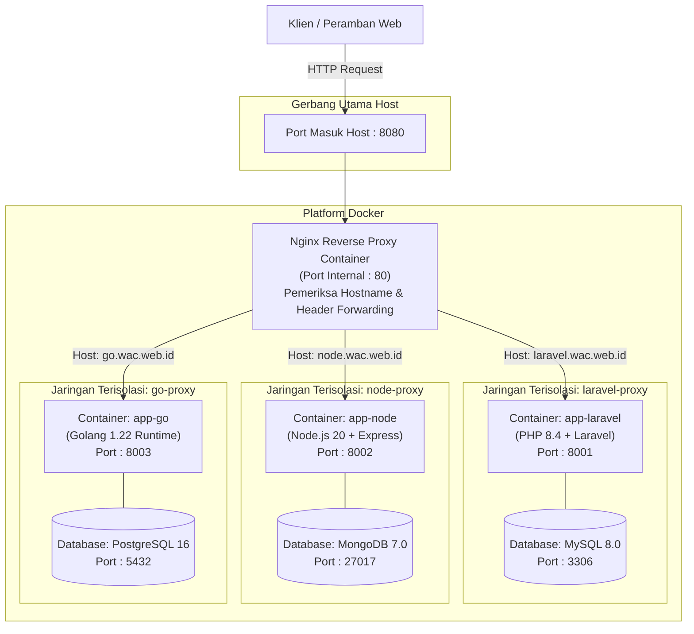
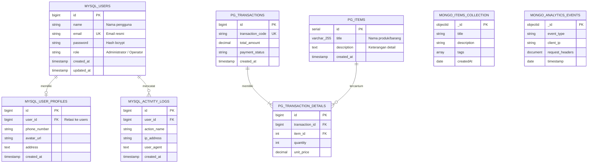

# Dokumentasi Teknis Sistem & Skema Database

Dokumen ini memuat spesifikasi arsitektur reverse proxy dan skema basis data terdistribusi (*polyglot persistence*) untuk laboratorium sistem backend terintegrasi.

---

## 1. Arsitektur Nginx Reverse Proxy & Jaringan Container

---

## 2. Skema Basis Data (Entity Relationship Diagram)

---

## 3. Spesifikasi Layanan & Protokol Jaringan

| Layanan | Teknologi & Runtime | Database | Port Internal | Virtual Host / Server Name |
|---|---|---|---|---|
| **Layanan Utama** | PHP 8.4 + Laravel 11 | MySQL 8.0 | `8001` | `laravel.wac.web.id` |
| **Layanan Dokumen & API** | Node.js 20 + Express | MongoDB 7.0 | `8002` | `node.wac.web.id` |
| **Layanan Komputasi & Transaksi** | Golang 1.22 Runtime | PostgreSQL 16 | `8003` | `go.wac.web.id` |
| **Reverse Proxy Gateway** | Nginx 1.27 Alpine | - | `80` (Host: `8080`) | `*.wac.web.id` |

